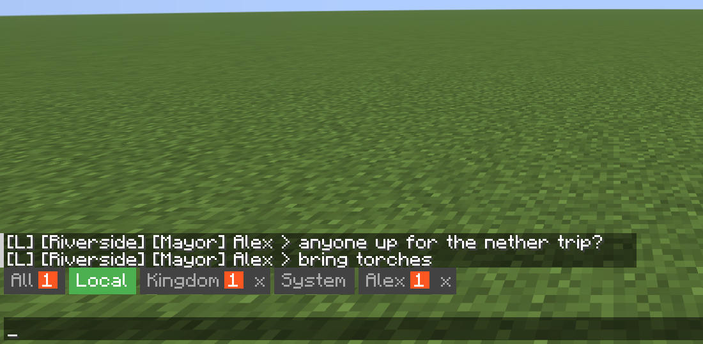
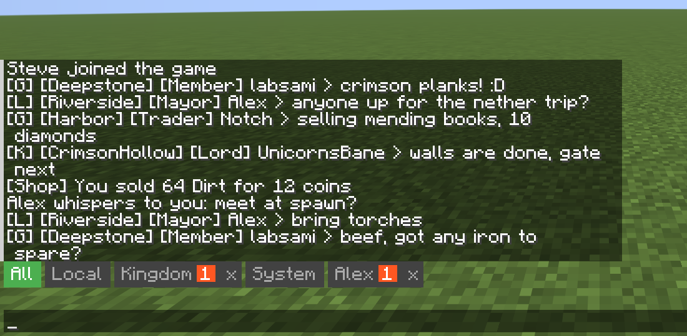
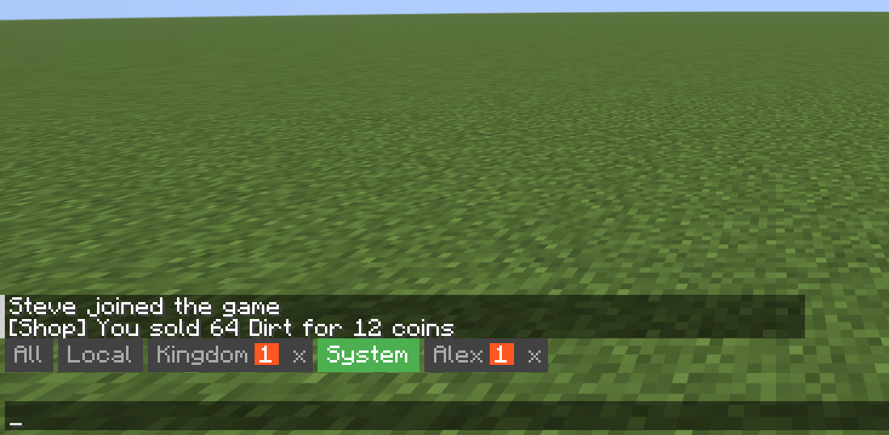
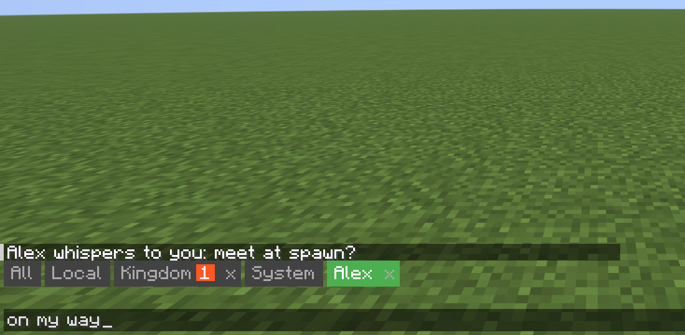
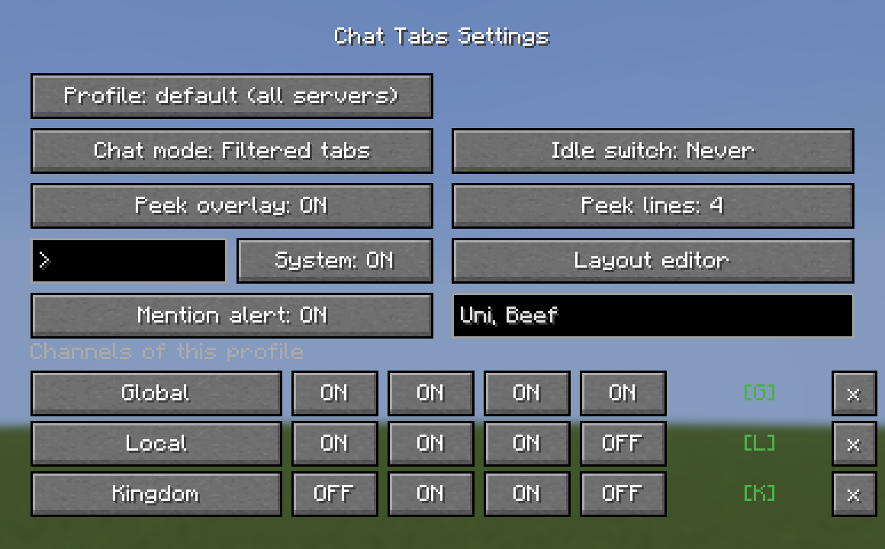

# Chat Tabs

A client-side Fabric mod that adds tabbed chat to Minecraft. Automatically sorts messages into **All**, **Local**, and per-player **DM** tabs based on server chat prefixes (`[G]`, `[L]`, `/tell`).

Built for servers that use `[G]`/`[L]` channel prefixes and `/tell` for direct messages. Tested on Lunar Client (1.21.11).



| All tab | System tab | DM tab |
|---|---|---|
|  |  |  |



## Features

- **All / Local tabs** — filter chat by `[G]` global and `[L]` local channels
- **Auto DM tabs** — new tabs appear automatically when you send or receive a `/tell` message, with a close button to dismiss them
- **Unread indicators** — orange badge with count on inactive tabs
- **Sound notifications** — pling sound when messages arrive in inactive tabs; louder distinct pling for name mentions
- **Mention alert** — when someone writes your player name or one of your nicknames (settings: *Mention alert*, *My names*), you get a badge and a pling even in quiet channels. Lines without their own tab (e.g. Global) badge the All tab. Whole words only; your own lines never count
- **System tab** — optional tab with server messages (joins, shop notices, command replies); they stay in All as well
- **Auto channel switching** — selecting a tab sends the appropriate `/g` or `/l` command to the server
- **Selectable chat mode** — switch between filtered tabs and single-window send-target tabs via command
- **Idle auto-switch to All** — optional timeout to fall back from Local/DM tabs to All after inactivity
- **DM failure mirroring** — delivery errors like offline/unreachable players are mirrored into the relevant DM tab instead of only being noticeable in All
- **Chat Heads compatibility** — strips `[PlayerName head]` placeholders before parsing

## Installation

Requires [Fabric Loader](https://fabricmc.net/) and [Fabric API](https://modrinth.com/mod/fabric-api).

1. Download the latest JAR from [Releases](https://github.com/paraf0x/mc_chat_tabs/releases)
2. Drop it into your `mods/` folder
3. Launch the game

## Commands

Client-side settings command:

- `/chattabs idle` — show current idle timeout
- `/chattabs idle <seconds>` — switch active Local/DM context back to All after that many seconds of inactivity
- `/chattabs idle never` — disable idle auto-switching
- `/chattabs mode` — show current chat mode
- `/chattabs mode filtered` — classic Chat Tabs behavior (tab-based message filtering)
- `/chattabs mode single` (or `single-window`) — keep vanilla single chat window, tabs only set send target and active highlight
- `/chattabs peek` — show global peek status and line count
- `/chattabs peek on|off` — enable/disable global peek overlay
- `/chattabs peek lines <count>` — set peek lines (1-10)
- `/chattabs peek position` — open draggable layout screen
- `/chattabs peek reset` — reset peek position/width to auto
- `/chattabs layout` — open layout screen for chat offset + peek placement
- `/chattabs layout reset` — reset chat offset and peek layout defaults

The setting is stored in `config/chattabs.json`.

## Building

```
./gradlew build
```

The output JAR is in `build/libs/`.

## License

[MIT](LICENSE)
